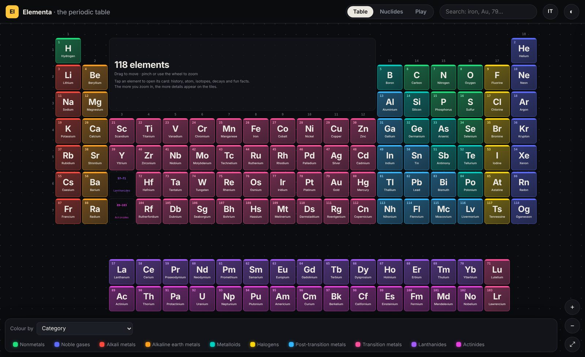
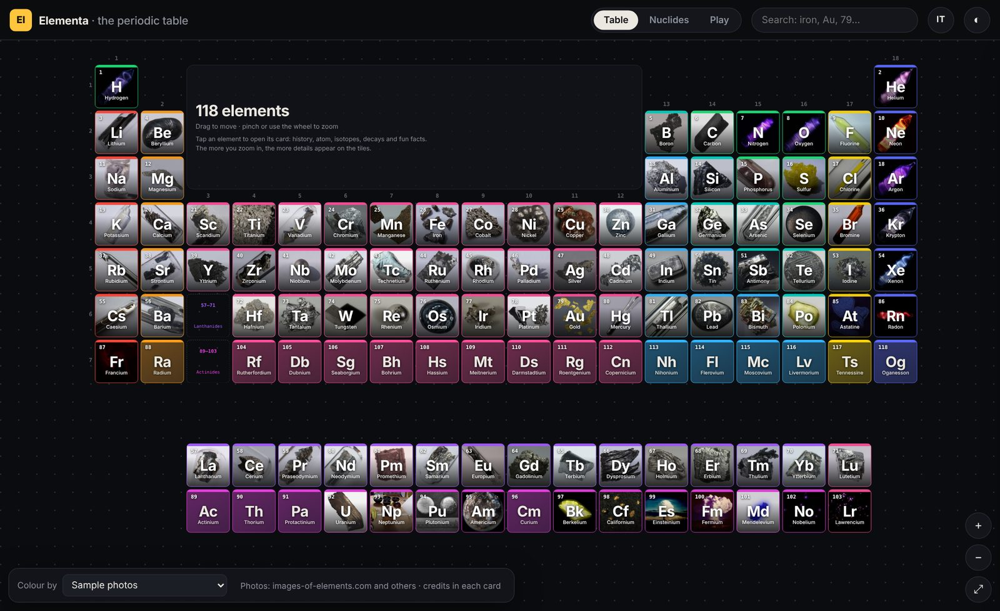
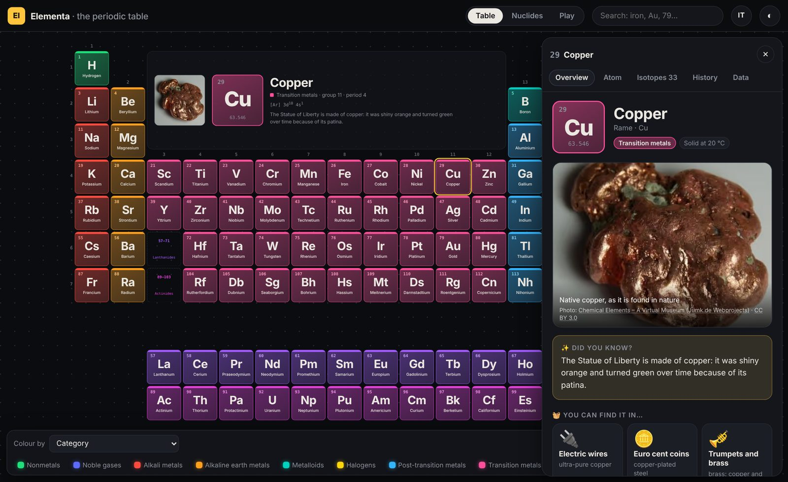
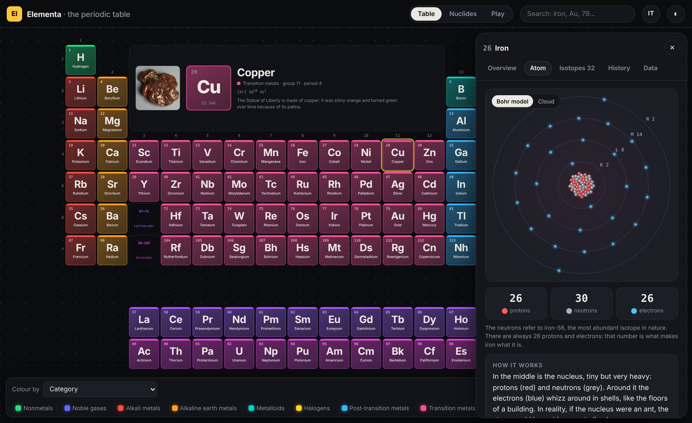
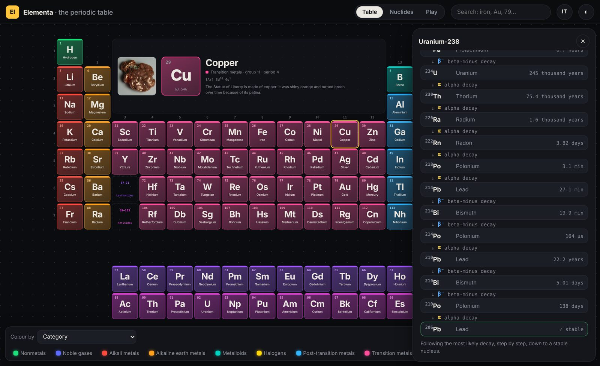
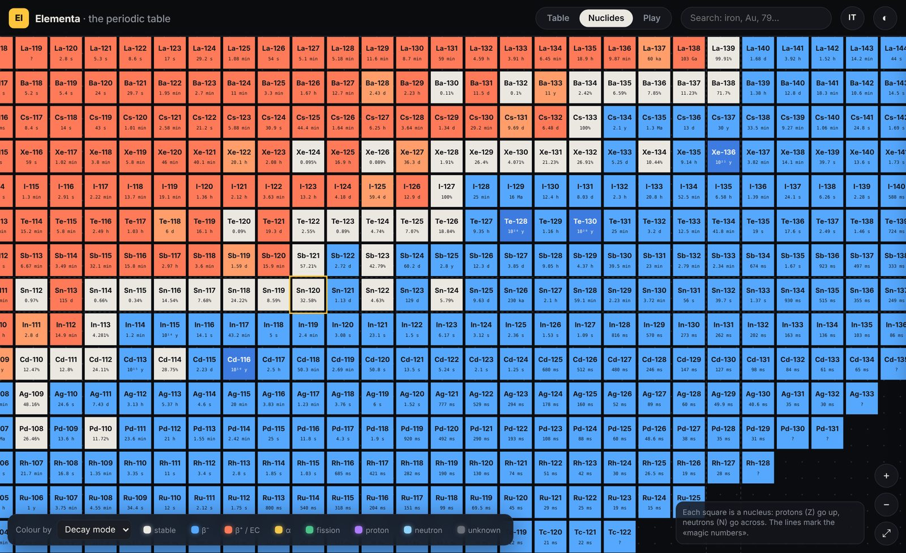
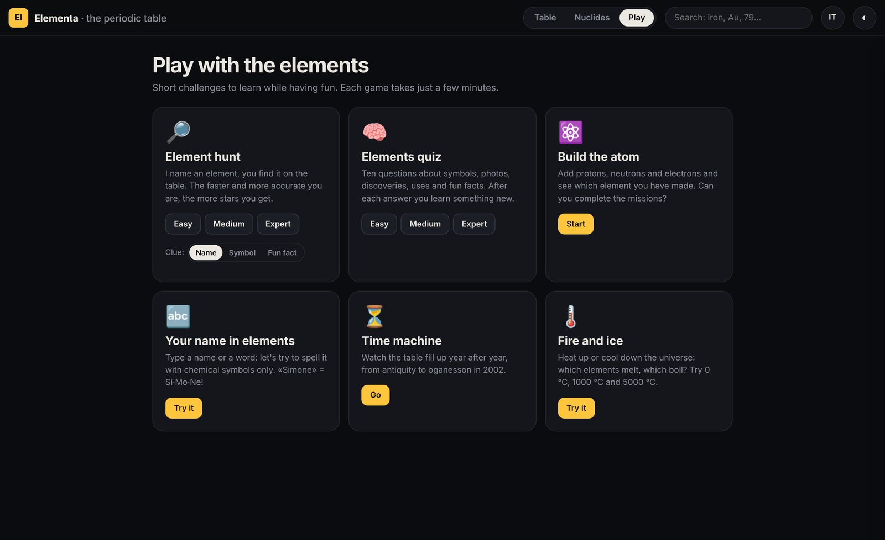
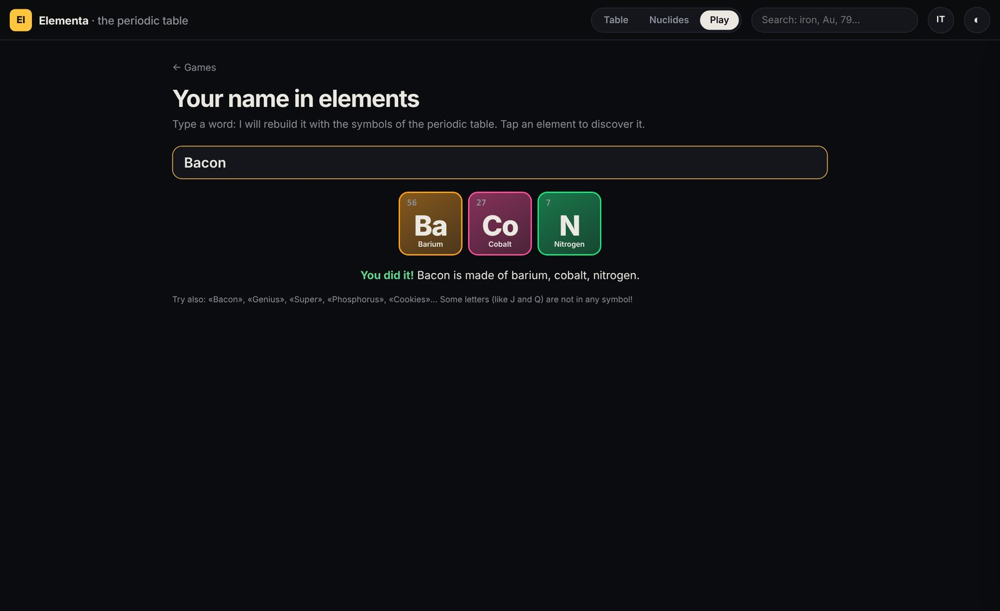
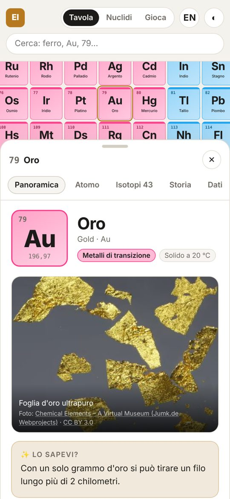

# Elementa

**An interactive periodic table to explore, study and play with — in English and Italian.**
**La tavola periodica interattiva da esplorare, studiare e con cui giocare — in italiano e in inglese.**

### ▶ [Open Elementa / Apri Elementa — simmonsstummer.github.io/elementa](https://simmonsstummer.github.io/elementa/)

Elementa runs in the browser, on desktop and phone, with nothing to install and no server-side code: it is made of static files only.

[English](#english) · [Italiano](#italiano)



| | |
|---|---|
|  |  |
| **Sample photos** on every tile / **Foto dei campioni** su ogni casella | **Element card** / **Scheda dell'elemento** |
|  |  |
| **Animated atom**, shells and orbitals / **Atomo animato**, gusci e orbitali | **Decay chain** of uranium-238 / **Catena di decadimento** dell'uranio-238 |
|  |  |
| **Chart of nuclides**: 3,557 isotopes / **Carta dei nuclidi**: 3.557 isotopi | **Games** for kids and grown-ups / **Giochi** per grandi e piccoli |

<p align="center">
  
  &nbsp;
  
</p>
<p align="center"><sub>«Your name in elements» · on a phone, in Italian / «Il tuo nome con gli elementi» · da telefono, in italiano</sub></p>

<sub>The screenshots show sample photos credited in <a href="img/CREDITS.md">img/CREDITS.md</a> (mostly CC BY 3.0, images-of-elements.com). / Gli screenshot contengono foto accreditate in <a href="img/CREDITS.md">img/CREDITS.md</a>.</sub>

---

## English

### What's inside

- **Explorable table** – drag to move, zoom with the mouse wheel or by pinching; the closer you zoom, the more details appear on each tile.
- **Colour modes** – category, sample photos, state of matter with a temperature slider, block, year of discovery (with an animated «time machine»), electronegativity, atomic radius, ionisation energy, density, melting point, crustal abundance, stability.
- **A card for every element**
  - *Overview*: photo, fun fact, «you can find it in…», uses, where it is found, key data.
  - *Atom*: animated Bohr model or electron cloud, shells, electron configuration, orbital diagram.
  - *Isotopes*: all 3,557 known isotopes with half-life, natural abundance and decay modes.
  - *History*: discoverers, place, origin of the name, position on the timeline.
  - *Data*: full physical and chemical properties.
- **Isotope detail** – half-life with child-friendly comparisons, decay modes explained, the full decay chain (e.g. uranium-238 → lead-206) and a half-life simulator with 100 atoms.
- **Chart of nuclides** – every known nucleus, zoomable, coloured by decay mode or half-life.
- **Games** – element hunt (3 levels), quiz with always-different questions (also about photos), build the atom with missions, your name in chemical symbols, time machine, fire and ice.
- **Two languages** – Italian and English, switchable at any time with the IT/EN button (the first choice follows the browser language).

### Run it or put it on your website

Copy all the files (including the `img/` folder) into any folder of a web server, for example `public_html/elementa/`. No PHP, database or build step is needed.

The app loads `elements.json` with `fetch`, so **it does not work by double-clicking `index.html`** (`file://`). To try it locally, start a small server in the folder:

```
python -m http.server 8000
```

and open http://localhost:8000.

The public version runs on GitHub Pages from the `main` branch: every push to `main` updates https://simmonsstummer.github.io/elementa/.

Direct links: `#fe` opens iron (any symbol works), `#nuclides` and `#play` open those views.

### Files

| File | Contents |
|---|---|
| `index.html`, `style.css` | page and style (light/dark theme) |
| `i18n.js` | all interface texts, Italian and English |
| `core.js` | data helpers, number formatting, electron configuration, decays, pan/zoom |
| `atom.js` | animated atom model |
| `table.js` | periodic table and colour modes |
| `panel.js` | element and isotope cards, half-life simulator |
| `nuclides.js` | chart of nuclides |
| `games.js` | games |
| `main.js` | startup, search, theme, language |
| `elements.json` | generated data (do not edit by hand) |
| `img/` | sample photos, with `img/CREDITS.md` |
| `tools/` | scripts that rebuild `elements.json`, and the source texts |
| `docs/` | screenshots for this README |

### Editing the texts or updating the data

Texts live in `tools/testi/`, one set per language:

- `it1…it4.json`, `en1…en4.json`: name, year, discoverers, place, name origin, story, where it is found, uses, fun fact;
- `cont_it1…3.json`, `cont_en1…3.json`: «you can find it in…» lists (emoji, item, note);
- `didascalie_it.json`, `didascalie_en.json`: photo captions;
- `crediti_foto.json`: author, license and source of each photo.

Then rebuild:

```
pip install mendeleev
python tools/build.py
```

This regenerates `elements.json` and `img/CREDITS.md`.

### Licenses

- **Code**: MIT — see [`LICENSE`](LICENSE).
- **Texts** (both languages): CC BY 4.0 — see [`LICENSE-CONTENT.md`](LICENSE-CONTENT.md).
- **Photos, data and fonts by third parties** keep their own licenses — see [`CREDITS.md`](CREDITS.md) and [`img/CREDITS.md`](img/CREDITS.md). Most photos are CC BY 3.0 from *Chemical Elements – A Virtual Museum* (images-of-elements.com); some are public domain; one (caesium) is CC BY-SA 3.0. If you reuse a photo, keep its credit.

The texts were written with the help of an AI model and checked by hand on a sample: if you spot a mistake, please open an issue or a pull request.

---

## Italiano

### Cosa contiene

- **Tavola esplorabile** – si trascina, si zooma con la rotella o pizzicando; più ingrandisci, più dettagli compaiono sulle caselle.
- **Modalità di colore** – categoria, foto dei campioni, stato fisico con cursore della temperatura, blocco, anno di scoperta (con «macchina del tempo» animata), elettronegatività, raggio atomico, ionizzazione, densità, punto di fusione, abbondanza, stabilità.
- **Scheda di ogni elemento**
  - *Panoramica*: foto, curiosità, «Lo trovi in…», usi, dove si trova, dati principali.
  - *Atomo*: modello di Bohr animato o nuvola elettronica, gusci, configurazione, diagramma degli orbitali.
  - *Isotopi*: tutti i 3.557 isotopi noti con durata, abbondanza naturale e modi di decadimento.
  - *Storia*: scopritori, luogo, origine del nome, posizione sulla linea del tempo.
  - *Dati*: proprietà fisiche e chimiche complete.
- **Dettaglio isotopo** – tempo di dimezzamento con paragoni comprensibili, decadimenti spiegati, catena di decadimento completa (es. uranio-238 → piombo-206) e simulatore del dimezzamento con 100 atomi.
- **Carta dei nuclidi** – tutti i nuclei conosciuti, zoomabili, colorati per decadimento o per durata.
- **Giochi** – caccia all'elemento (3 livelli), quiz con domande sempre diverse (anche sulle foto), costruisci l'atomo con missioni, il tuo nome con i simboli chimici, macchina del tempo, fuoco e ghiaccio.
- **Due lingue** – italiano e inglese, si cambia in qualsiasi momento con il pulsante IT/EN (la prima volta segue la lingua del browser).

### Metterlo sul proprio sito

Basta copiare tutti i file (compresa la cartella `img/`) in una cartella del sito, per esempio `httpdocs/elementa/`. Non servono PHP, database o build.

L'app carica `elements.json` con `fetch`, quindi **non funziona aprendo `index.html` con doppio clic** (`file://`). Per provarla in locale avvia un piccolo server nella cartella:

```
python -m http.server 8000
```

e apri http://localhost:8000.

La versione pubblica gira su GitHub Pages dal branch `main`: ogni push su `main` aggiorna https://simmonsstummer.github.io/elementa/.

Link diretti: `#fe` apre il ferro (vale per ogni simbolo), `#nuclidi` e `#gioca` aprono quelle viste.

### Modificare i testi o aggiornare i dati

I testi stanno in `tools/testi/`, un gruppo di file per lingua (vedi l'elenco nella sezione inglese). Dopo una modifica:

```
pip install mendeleev
python tools/build.py
```

che rigenera `elements.json` e `img/CREDITS.md`.

### Licenze

- **Codice**: MIT — vedi [`LICENSE`](LICENSE).
- **Testi** (entrambe le lingue): CC BY 4.0 — vedi [`LICENSE-CONTENT.md`](LICENSE-CONTENT.md).
- **Foto, dati e caratteri di terze parti** mantengono le proprie licenze — vedi [`CREDITS.md`](CREDITS.md) e [`img/CREDITS.md`](img/CREDITS.md). Quasi tutte le foto sono CC BY 3.0 di *Chemical Elements – A Virtual Museum* (images-of-elements.com); alcune sono di pubblico dominio; una (cesio) è CC BY-SA 3.0. Se riusi una foto, mantieni il suo credito.

I testi sono stati scritti con l'aiuto di un modello di intelligenza artificiale e verificati a campione: se trovi un errore, apri una issue o una pull request.
